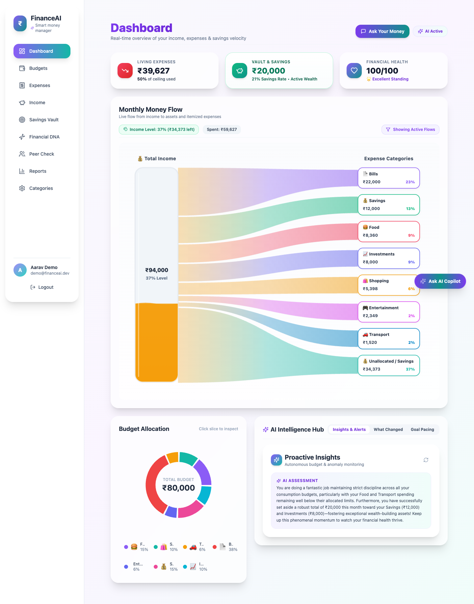
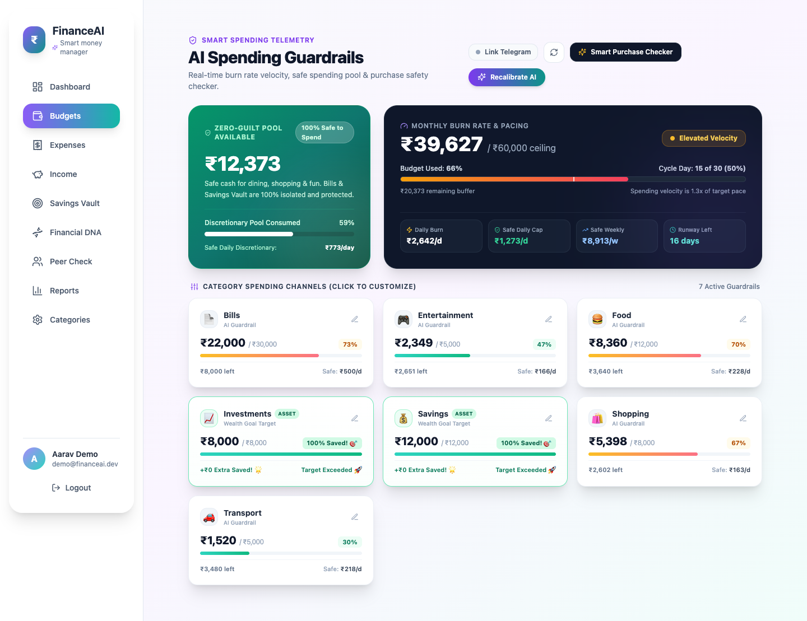
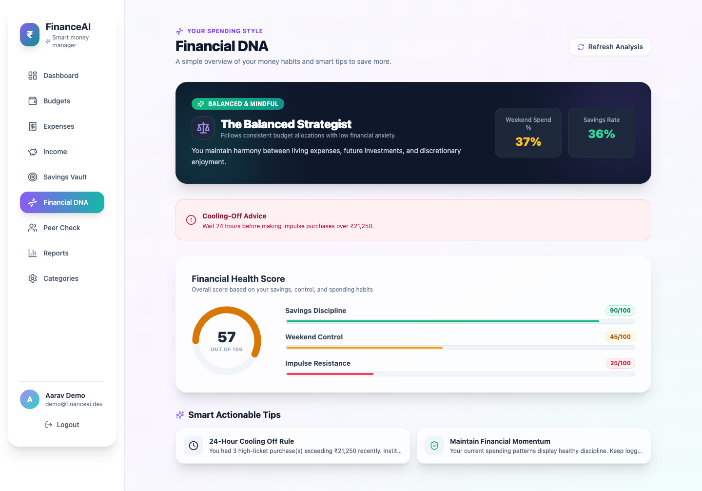
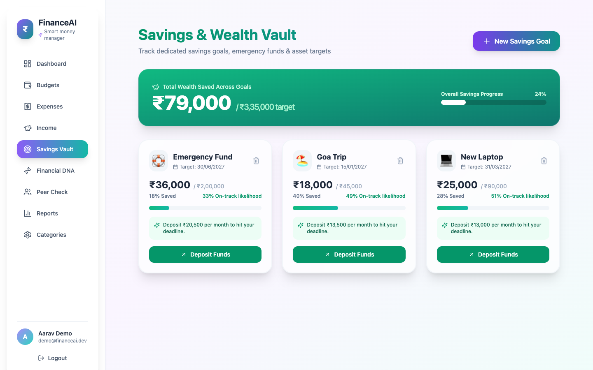
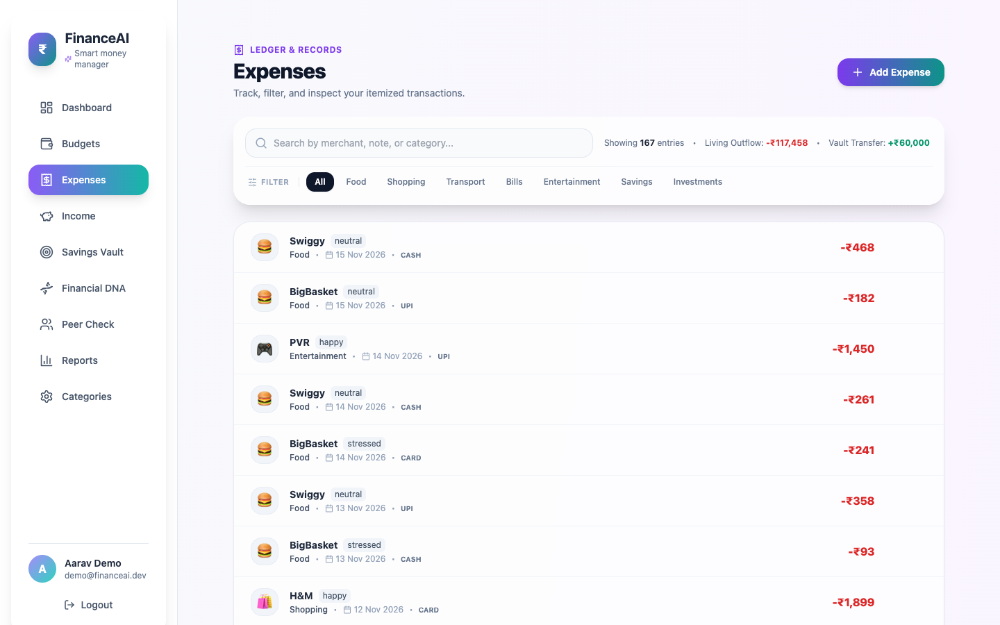
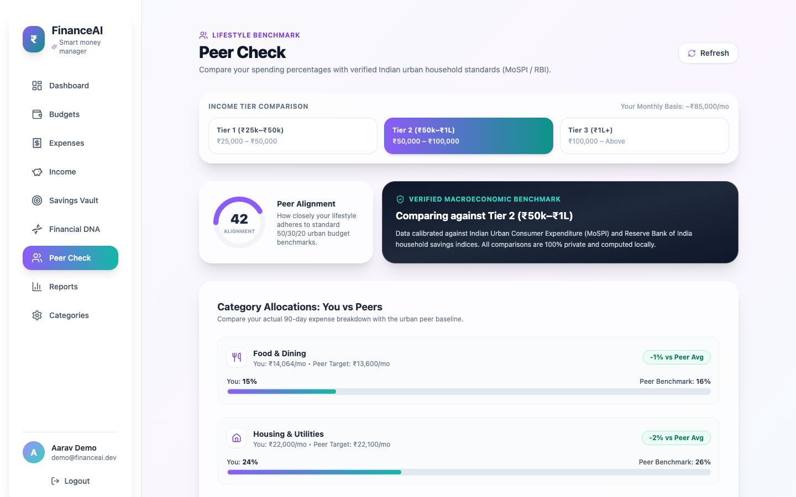
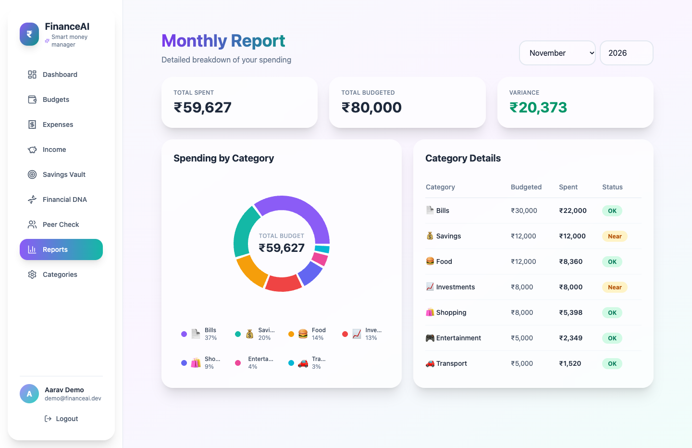
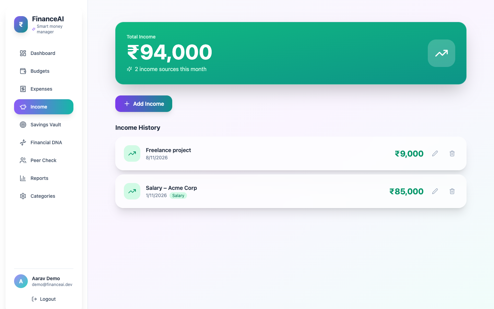
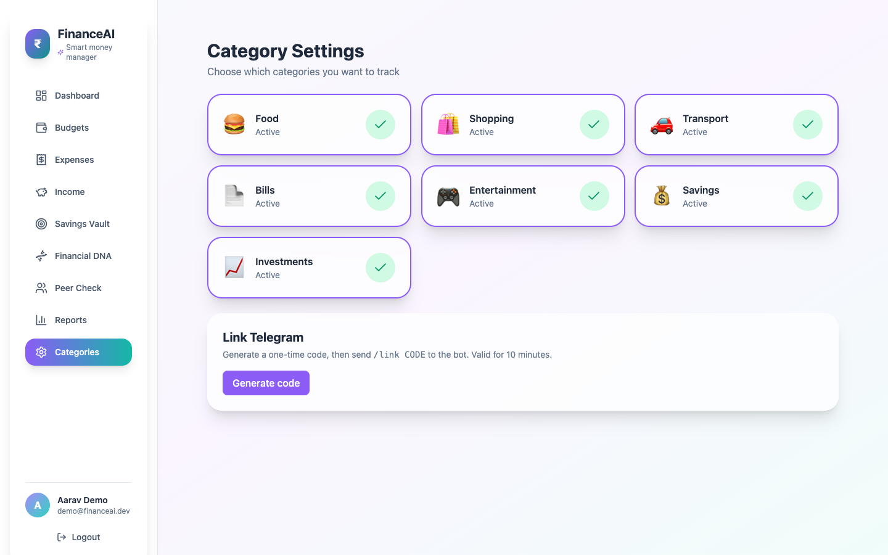
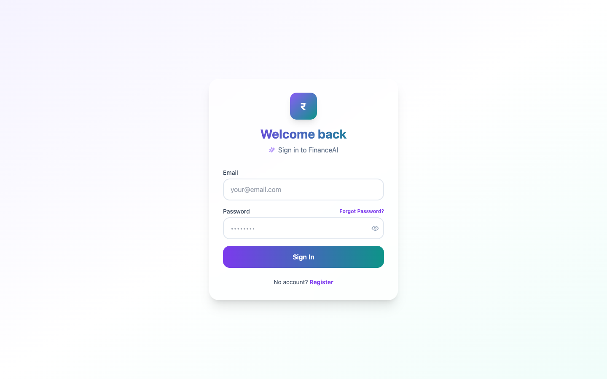

# 💸 FinanceAI Manager

A modern, full-stack personal finance and wealth management platform powered by PostgreSQL, Express, React, and an AI-driven multimodal Telegram bot. Track expenses seamlessly via web, receipt photos, or voice notes, and discover your financial behavioral personality with Financial DNA analytics.

---

## 🌟 Key Features

### 1. 🤖 Multimodal Telegram Bot Integration
- **Text Expense Logging:** Add expenses naturally via standard Telegram text messages (e.g., `2500 Zara` or `50 coffee`).
- **Receipt OCR:** Snap and upload receipt photos—Google Gemini Flash automatically extracts the vendor, line items, total amount, and category.
- **Voice Note Parsing:** Send a quick voice memo—Groq Whisper transcribes speech into text in milliseconds, and Gemini categorizes and saves it directly to your database.
- **Brand & Merchant Awareness:** Intelligent category mapping correctly routes retail and fashion brands (like Zara, H&M, Nike) to `Shopping` instead of generic dining categories.

### 2. 🧬 Financial DNA & Spending Persona Engine
- **Behavioral Archetypes:** Identifies your spending personality based on transaction history (e.g., *The Weekend Splurger*, *Fortress Saver*, *Balanced Strategist*).
- **5-Pillar Health Score:** Analyzes Savings Rate, Budget Discipline, Consistency, Discretionary Control, and Impulse Resistance.
- **Actionable Insights:** Algorithmic recommendations that target your biggest spending leaks and set custom cooling-off limits.

### 3. 📊 Visual Dashboard & Flow Tracking
- **Cash Flow Visualization:** Interactive Sankey charts and category breakdowns.
- **Budget Tracking:** Real-time progress bars for category caps with visual overrun warnings.
- **Financial Goals:** Milestone prediction and savings targets.

### 4. 🔐 Security & Auth
- Secure JWT authentication with hashed credentials (`bcryptjs`).
- Show/Hide interactive password visibility toggles.
- **Telegram OTP Password Reset:** One-click zero-cost reset code delivered directly to your linked Telegram account.

---

## 📸 Screenshots

> Captured from a seeded demo account (synthetic data).

### Dashboard — cash flow, budget allocation & AI Intelligence Hub


| Budgets — AI spending guardrails | Financial DNA — persona & health score |
|---|---|
|  |  |

| Savings Vault — deadline-aware goal pacing | Expenses |
|---|---|
|  |  |

| Peer Check — benchmarks by income tier | Reports |
|---|---|
|  |  |

| Income | Category settings & Telegram linking |
|---|---|
|  |  |

<details><summary>Login</summary>


</details>

---

## 🛠️ Tech Stack

### Frontend
- **Framework:** React 18 (Vite)
- **Styling:** Tailwind CSS, Framer Motion
- **Icons & Visuals:** Lucide React, Recharts
- **Notifications:** React Hot Toast

### Backend
- **Runtime:** Node.js (ES Modules) & Express.js
- **Database:** PostgreSQL (`pg` connection pool)
- **Bot Engine:** `node-telegram-bot-api`
- **AI & Speech Models:**
  - Google Gemini Flash (`@google/genai`)
  - Groq Cloud Whisper Large v3 (`groq-sdk`)

---

## 🚀 Getting Started

### Prerequisites
- Node.js (v18+)
- PostgreSQL installed and running locally
- Telegram Bot Token (from [@BotFather](https://t.me/botfather))
- Free API Keys:
  - [Google AI Studio](https://aistudio.google.com/) (Gemini API)
  - [Groq Cloud](https://console.groq.com/) (Whisper API)

---

### Installation & Setup

#### 1. Clone the repository
```bash
git clone https://github.com/sanghavivraj/finance-ai-manager.git
cd finance-ai-manager
```

#### 2. Configure environment
```bash
cp server/.env.example server/.env   # then fill in JWT_SECRET, TELEGRAM_BOT_TOKEN, GEMINI_API_KEY, GROQ_API_KEY
```

#### 3a. Run with Docker (one command)
```bash
docker compose up --build            # app on http://localhost:3000
```

#### 3b. Run manually
```bash
createdb finance_manager && psql finance_manager -f database/schema.sql
cd server && npm install && npm run dev      # API on :5000
cd client && npm install && npm run dev      # UI on :3000
```

#### 4. Link Telegram
In the web app open **Category Settings → Link Telegram → Generate code**, then send `/link CODE` to your bot.

---

## 🔒 Security

- bcrypt password hashing, JWT auth, `helmet` headers, restricted CORS (`CLIENT_ORIGIN`)
- Rate limiting on login / register / password reset and on AI endpoints
- Password reset: CSPRNG 6-digit OTP, stored hashed, requires email + code, locked after 5 wrong attempts, 15 min expiry
- Telegram linking uses short-lived one-time codes (no email-only linking)
- Category on/off settings are per user

## 🧪 Tests & CI

```bash
cd server && npm test      # Vitest + Supertest, no database required
```
GitHub Actions runs server validation + tests and the client build on every push.
